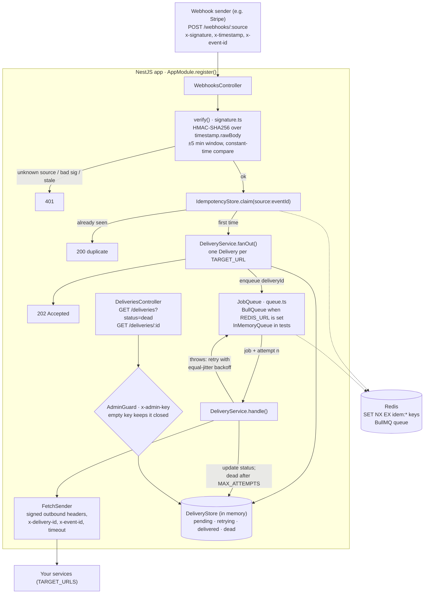

# nest-webhook-gateway

Receives webhooks, proves they are authentic, deduplicates them, and delivers them to your services
with retries, jittered backoff and a dead-letter list. NestJS, TypeScript, BullMQ on Redis.

```
sender -> POST /webhooks/:source -> verify HMAC + timestamp -> claim event id (idempotency)
       -> 202 -> queue -> worker -> POST each target (signed) -> retry with backoff -> dead
```

## Architecture



## What it demonstrates

| Concern | How |
|---|---|
| Authenticity | HMAC-SHA256 over `timestamp.rawBody`, constant-time compare, raw bytes preserved with `rawBody: true` |
| Replay protection | Timestamp must be within 5 minutes (past or future), and is part of the signature |
| Idempotency | `source:x-event-id` claimed once. Memory store, or Redis `SET NX EX` for multiple instances |
| Fast acknowledgement | Responds 202 before delivery. Sender is never blocked by a slow target |
| Reliable delivery | BullMQ retries survive restarts. Equal-jitter exponential backoff avoids retry storms |
| Dead-letter | After `MAX_ATTEMPTS` a delivery is `dead`, listed at `GET /deliveries?status=dead` |
| Isolation | One failing target never blocks another |
| Safe defaults | Unknown source and bad signature both return 401. Admin routes stay closed if `ADMIN_KEY` is empty |

## Run

```bash
npm ci
npm test                          # unit and e2e, no services needed
redis-server &                    # or: docker compose up redis
npm run test:redis                # BullMQ and Redis idempotency against a real Redis
cp .env.example .env && docker compose up --build
```

Send a test event:

```bash
BODY='{"id":"evt_1","amount":5}'; TS=$(date +%s)
SIG="sha256=$(printf '%s.%s' "$TS" "$BODY" | openssl dgst -sha256 -hmac 'whsec_change_me' | cut -d' ' -f2)"
curl -i localhost:3000/webhooks/stripe -H "content-type: application/json" \
  -H "x-timestamp: $TS" -H "x-signature: $SIG" -H "x-event-id: evt_1" -d "$BODY"
```

## Design decisions

- **Sign the timestamp with the body.** Otherwise an attacker can replay a captured request forever.
- **Verify before parsing.** Nothing untrusted is parsed or stored until the signature passes.
- **Acknowledge, then deliver.** Webhook senders retry on slow responses, which causes duplicates.
- **Idempotency lives at the edge, receivers should still dedupe** on the `x-event-id` we forward.
- **Queue behind an interface.** `InMemoryQueue` makes tests fast and deterministic, `BullQueue` is
  the production adapter, and both are covered by the same retry logic and backoff function.

## Verified here

17 unit and e2e tests pass. The 2 Redis integration tests pass against a local `redis-server`.
The Docker image was built and run against a local Redis: `/health` answered and a signed event got `202`.
The compose file was not run.

## Deploy (free)

A **Render free web service** (from the `Dockerfile`) plus a **Render free Key Value** instance
(Redis-compatible, `noeviction` as BullMQ requires). In Render: New, Blueprint, pick this repo,
then set `SIGNING_SECRETS` and `TARGET_URLS` when prompted. The full guide, including why this repo
stays on Render rather than Vercel (the BullMQ worker must stay running between requests), is in
[docs/deployment.md](docs/deployment.md).

A stateless demo of the HTTP API also runs on Vercel at <https://nest-webhook-gateway.vercel.app>
(in-memory queue, no forwarding, so delayed retries don't survive there).

- Free web instances sleep after about 15 minutes idle; a sender retrying on timeout will wake it.
- Free Key Value has no persistence, so queued retries are lost if it restarts. Demo only.

## Known limits

- Delivery records live in memory. Swap `DeliveryStore` for Postgres to survive restarts.
- No per-target secrets or per-source target routing yet, and no payload size limit beyond Express's default.
- A delivery counts as an attempt only after the HTTP call, a crash mid-call can cause a duplicate delivery
  (at-least-once). Targets must be idempotent.

## Changelog and contributing

Every change adds an entry under **Unreleased** in [`CHANGELOG.md`](CHANGELOG.md) and updates the
docs it affects (this README, `docs/`, and `NOTES.md` for mistakes). A CI job fails any pull request
that skips the changelog (label it `skip-changelog` for changes that truly need none). Before
opening a PR:

```bash
npm run typecheck && npm test
npm run test:redis   # needs a local Redis
```

See `NOTES.md` for mistakes made and fixed.
